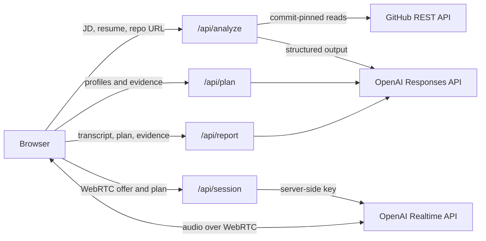

# MockMate AI

**Practice for the Company, Prove Your Skills.**
*A project-aware, company-style AI mock interviewer that studies your work before asking you questions.*

**Live demo:** https://mockmate-tan.vercel.app/ (add `?mock=1` for a scripted run with no microphone and no AI calls)

Built for UF Gator Hack V (October 2026).

## Status

| Part | State |
|---|---|
| Four-step web flow: Prepare, Plan, Interview, Review | Working |
| Job description, resume (PDF or text) and optional GitHub repository analysis | Working |
| Structured interview plan with file-path evidence | Working |
| Live voice interview (OpenAI Realtime over WebRTC) | Working |
| Evidence-based feedback report | Working |

## The Problem

Technical interviews rarely stop at definitions. Interviewers ask *why* you chose a model, how you debugged a failure, and what you would change in your own code. Many AI mock-interview tools can already generate questions from a job description and run a voice conversation. But they rarely look at the candidate's actual projects, so the questions and feedback stay generic.

## What MockMate Does

1. **Reads your materials:** paste a job description, upload your resume (PDF or text), and optionally add a public GitHub repository. If you leave it blank, MockMate uses the first repository link in your resume, if there is one.
2. **Studies your project:** MockMate reads the repository's README, file structure, and a few key source files, and records exactly which files it inspected.
3. **Plans the interview:** it prepares questions linked to the job's requirements and to real details in your code. Before you start, you see the focus areas and the code files behind each one; the exact questions stay private until the interview, like a real one.
4. **Interviews you by voice:** a realistic AI interviewer talks with you in real time. You can interrupt, ask it to repeat, and it follows up on what you actually said.
5. **Gives evidence-based feedback:** after the interview, you get a report. Each point quotes your own words from the transcript and, for project facts, points to the file it came from.

## Features

- Two interview modes: **Technical** and **Behavioral**, with different questions and different scoring dimensions.
- Two interview lengths: a quick **5-minute** practice (default) or a fuller **15-minute** interview.
- Three company types: **Tech**, **Business** and **Entertainment**, each with its own focus areas, follow-up style and original practice questions. *(Practice styles based on public information about each industry; not affiliated with or endorsed by any company.)*
- Real-time voice conversation in the browser, with no app to install.
- A full transcript with clear speaker labels.
- Feedback by dimension: what you demonstrated, what remains unclear, why it matters for the job, how to explain it better, and a next practice question.
- A provisional 0–100 practice score, shown only when at least two dimensions have evidence-backed scores, with the formula and its coverage explained.
- Transparent analysis: you can see which repository files the AI inspected.

## How It Works (non-technical)

1. **Prepare:** MockMate pulls the key skills from the job description and the projects from your resume, then reads selected files from your repository, if one is available.
2. **Plan:** an AI model writes a short, structured interview plan from those materials.
3. **Talk:** a voice AI runs the interview using the plan, choosing follow-ups based on your answers.
4. **Review:** a separate AI model grades the transcript against a written rubric and cites the evidence for every comment.

## Architecture

MockMate is a single Next.js app deployed on Vercel. Every API route is stateless: nothing is stored on the server, and the browser carries the results from one step to the next.



| Step | Route | What it does |
|---|---|---|
| Analyze | `POST /api/analyze` | Parses the resume (PDF via `unpdf`, or pasted text). Reads the GitHub repository pinned to its latest commit SHA: README, dependency manifests, then core source files, within fixed size limits. Asks `PLANNER_MODEL` for structured job and candidate profiles, where every piece of evidence has a server-issued ID. If the repository cannot be read, analysis continues with the resume and job description and shows a warning. |
| Plan | `POST /api/plan` | Asks `PLANNER_MODEL` for a short interview plan: for 5 minutes, 2 technical or 1 behavioral question; for 15 minutes, 5 technical or 3 behavioral questions. Each question is linked to job requirements and evidence IDs; the server drops unknown IDs and any question left without a real source. |
| Interview | `POST /api/session` | The browser sends its WebRTC offer and the plan. The server builds the interviewer instructions from the persona, rubric focus and company type in `content/`, then creates the Realtime call with the server-side key and returns only the answer SDP. Audio flows directly between the browser and OpenAI. The browser sends time cues near the end of the session and hangs up when time runs out. After about 10 seconds of silence it also sends a cue, so the interviewer checks in once and then moves on instead of waiting or repeating the question. |
| Report | `POST /api/report` | Asks `EVALUATOR_MODEL` to choose a rubric level for each dimension, citing transcript turns. The server checks every quote against the candidate's own complete turns and marks any dimension without a verified quote as "insufficient evidence". Scores and rubric wording come from the rubric files, not from the model. |

### Evidence and accuracy

- Every repository claim keeps `repoUrl`, `commitSha` and `path`, and line ranges where they can be checked. The plan page shows the file paths behind each focus area.
- Quotes in the report are matched against the transcript on the server. A "strong" or "medium" level needs a verified quote of at least six words.
- When there is not enough evidence, the report says "insufficient evidence" instead of guessing. "Not found in the inspected files" never means the candidate did not do it.

### Tech stack

- Next.js 16 (App Router, route handlers), React 19, TypeScript, Tailwind CSS 4
- OpenAI Responses API with strict JSON-schema output, validated again with `zod`
- OpenAI Realtime API over WebRTC, with built-in input transcription
- GitHub REST API (git trees and blobs, read-only)
- `unpdf` for resume text extraction
- Vercel for hosting

## Security, privacy and cost controls

- **Keys stay on the server.** `OPENAI_API_KEY` and `GITHUB_TOKEN` are server-side environment variables only. The browser never receives an OpenAI credential: `/api/session` creates the Realtime call on the server and returns only the WebRTC answer.
- **Untrusted input.** Job descriptions, resumes and repository files are treated as data, never as instructions. MockMate never runs code from a repository and skips dotfiles (including `.env*`), lock files, key files and likely secret files.
- **No storage, minimal logging.** Requests are processed in memory. Logs never contain keys, resumes, request bodies, transcripts or audio.
- **Cost limits.**
  - `AI_ENABLED` and `VOICE_ENABLED` kill switches: every paid route returns 503 unless they are set to `true`.
  - Input limits: job description and resume text up to 10,000 characters each; resume PDF up to 2 MB and 5 pages; up to 15 repository files, 50 KB each, 200 KB in total; reports up to 150 turns and 30,000 characters.
  - Rate limits per IP in a 10-minute window: 15 minutes of voice interviews (three 5-minute interviews or one 15-minute interview), 5 analyses, 5 plans and 5 reports. Voice is also capped at 750 interview minutes per day across all users.
  - Same-origin checks on every API route.
  - Interviews are 5 or 15 minutes long; the server accepts no other length.

## Limitations

- **Practice only:** feedback is not an employer evaluation or a hiring prediction.
- **Limited code reading:** MockMate reads only a limited number of files from public repositories. If something isn't found in the inspected files, that doesn't mean you didn't build it.
- **Imperfect transcription:** speech-to-text can make mistakes, especially with technical terms or accents, and this can affect feedback.
- **Company types are approximations:** each one is based on public, official hiring pages from several companies of that kind, not on any real company's internal process or question bank. The site never names those companies.
- **Session length:** sessions are short (5 or 15 minutes) to control cost.
- **Supported inputs:** English only. Resumes in PDF or plain text, public GitHub repositories only.

### Technical limitations

- **Evidence in reports comes from the browser.** The API is stateless, so `/api/report` receives the plan and code evidence from the browser and cannot re-check them against GitHub. Quotes are verified against the transcript, but a user who edits the request can change the code evidence in their own report.
- **Rate limits are best effort.** They are kept in memory per server instance and reset when an instance restarts.
- **The interview time limit is enforced in the browser.** The server sets up the session but cannot hang up a call that a modified client keeps open.
- **Resume links:** only repository links written out as text in the resume are detected. A link that exists only as a clickable label in a PDF is not.
- **Voice turn-taking is best effort.** The app's own prompts (silence check-ins, time cues, the closing line) and the model's automatic replies are not scheduled by one controller. In rare timing cases a check-in can overlap an answer that has just resumed, or a reply can be skipped.
- **Muting does not pause the interview.** The clock keeps running and the interviewer may continue after a partial answer; muting only stops silence check-ins.
- **Interviewer transcripts are what was generated, not exactly what was heard.** If you interrupt the interviewer, its turn can contain words that were never played, and a turn that finished generating before you interrupted is not marked as interrupted.
- **The last answer can be cut off.** At the time limit the app allows up to 15 extra seconds for a final answer and the closing line, then hangs up.
- **Follow-up depth varies by company type.** Some company types allow more follow-ups than the persona's default, so a 15-minute interview may not reach every planned question.

## Privacy

- Your resume, job description, repository content, and voice are sent to third-party AI services (OpenAI) to run the interview and create the report.
- MockMate does not store your data on a server. Your materials, transcript, and report live only in your browser tab and are cleared when you close it.
- Audio and video are not recorded or saved.
- Please don't upload documents that contain sensitive personal information you don't want processed.
- MockMate never runs code from your repository; it only reads text files.

## Run locally

Requires Node.js 24 and npm.

```bash
npm install
cp .env.example .env.local   # then fill in values; never commit .env.local
npm run dev
```

Open http://localhost:3000. Add `?mock=1` to the URL to use sample data and a scripted interview, with no microphone or API calls.

| Variable | Purpose |
|---|---|
| `OPENAI_API_KEY` | Server-side OpenAI key |
| `GITHUB_TOKEN` | Optional fine-grained, read-only token for public repositories. Without it, GitHub allows 60 requests per hour. |
| `REALTIME_MODEL` | Model for the voice interview |
| `TRANSCRIBE_MODEL` | Model for transcribing the candidate's speech |
| `PLANNER_MODEL` | Model for analysis and planning |
| `EVALUATOR_MODEL` | Model for the report |
| `REALTIME_VOICE` | Optional interviewer voice (default `marin`) |
| `AI_ENABLED`, `VOICE_ENABLED` | Must be `true` to allow paid calls and voice sessions |

Model IDs are configured only through these variables, never in code.

Checks: `npx tsc --noEmit`, `npm run lint`, `npm run build`. Release checks are in [`docs/release-checklist.md`](docs/release-checklist.md).

## Repository layout

| Path | Contents |
|---|---|
| `app/` | Pages and API routes (`app/api/`) |
| `components/mockmate/` | UI for the four interview steps |
| `lib/` | Server logic and the browser voice client (`lib/voice/`) |
| `types/` | Shared data contracts and limits |
| `mocks/` | Sample data and a mock voice session for UI work |
| `content/` | Interviewer personas, rubrics, company types and demo materials |
| `docs/` | Requirements brief, release checklist and submission drafts |

Contributor and agent rules are in [`AGENTS.md`](AGENTS.md).

## Team

Built at UF Gator Hack V (October 2026) by Jerry (backend, voice, integration), Yuki (frontend design and QA), and Lisa (product, content, pitch).

## License

[MIT](LICENSE)
